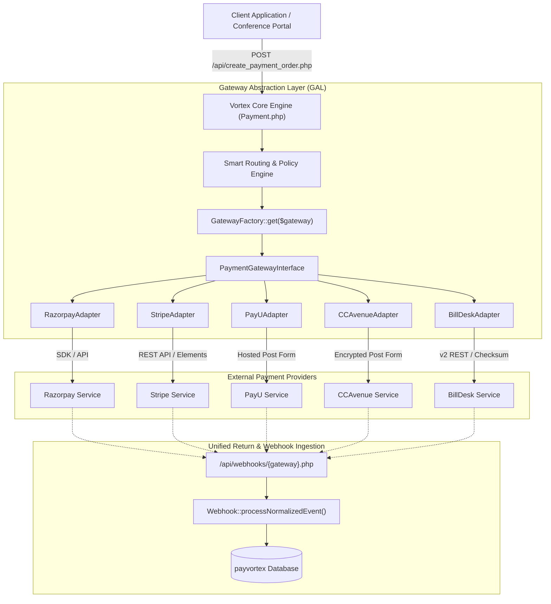

# Vortex Gateway Abstraction Layer (GAL) — Implementation Plan

**Objective:** Transition Vortex from a single-gateway (Razorpay-locked) model to an enterprise-grade **Omni-Gateway Architecture**. Enable plug-and-play support for **Stripe, PayU, CCAvenue, and BillDesk** (and any future providers) with zero rewriting of core transaction processing, merchant APIs, webhooks, or admin dashboards.

---

## 1. High-Level Architecture & Design Patterns



### Core Design Patterns
1. **Adapter Pattern (`PaymentGatewayInterface`)**: Defines a uniform contract for all gateway operations: order initialization, checkout launch payload, signature verification, status checks, and refunds.
2. **Factory Pattern (`GatewayFactory`)**: Resolves and instantiates the appropriate adapter based on merchant settings, transaction currency, or system default.
3. **Normalized Data Transfer Objects (DTOs)**:
   - `OrderRequestDTO` & `OrderResponseDTO`: Unifies amounts, currencies, order receipts, and client secrets.
   - `VerificationRequestDTO` & `VerificationResponseDTO`: Unifies payment IDs, signatures, and transaction timestamps.
   - `RefundRequestDTO` & `RefundResponseDTO`: Unifies refund IDs, partial amount handling, and gateway reference numbers.
   - `NormalizedWebhookDTO`: Converts disparate gateway webhooks into standard Vortex events (`PAYMENT_CAPTURED`, `REFUND_PROCESSED`, `PAYMENT_FAILED`, `DISPUTE_CREATED`).
4. **Smart Routing Strategy**:
   - **Currency Routing:** e.g., INR defaults to Razorpay/BillDesk/PayU; USD, EUR, GBP automatically route to Stripe.
   - **University & Merchant Preference:** Institutional fee payments can route directly through BillDesk or Razorpay based on the client preference (`preferred_gateway: "billdesk"`).
   - **Failover / Fallback:** If Gateway A reports downtime or returns HTTP 5xx, the routing engine can seamlessly fall back to Gateway B.

---

## 2. Gateway Contract & Interface Specification

### `PaymentGatewayInterface.php`
Every adapter implements this interface:

```php
namespace Vortex\Gateways;

interface PaymentGatewayInterface
{
    /**
     * Unique gateway identifier (e.g., 'razorpay', 'stripe', 'payu', 'ccavenue', 'billdesk')
     */
    public function getIdentifier(): string;

    /**
     * Human-readable gateway display name (e.g. 'BillDesk v2 Omni-Pay')
     */
    public function getDisplayName(): string;

    /**
     * Currencies supported by this provider
     */
    public function getSupportedCurrencies(): array;

    /**
     * Initialize payment order / intent with provider
     */
    public function createOrder(OrderRequestDTO $request): OrderResponseDTO;

    /**
     * Verify payment signature / callback authentication
     */
    public function verifyPayment(VerificationRequestDTO $request): VerificationResponseDTO;

    /**
     * Fetch real-time payment status from provider API
     */
    public function fetchStatus(string $gatewayOrderId, string $gatewayPaymentId): StatusResponseDTO;

    /**
     * Issue full or partial refund
     */
    public function processRefund(RefundRequestDTO $request): RefundResponseDTO;

    /**
     * Verify incoming webhook authenticity and normalize event
     */
    public function parseAndVerifyWebhook(string $rawPayload, array $headers): NormalizedWebhookDTO;

    /**
     * Returns checkout integration mode:
     * - 'modal' (Client-side JS popup like Razorpay or Stripe Elements)
     * - 'redirect' (Hosted checkout session or POST form like BillDesk / PayU / CCAvenue)
     */
    public function getCheckoutMode(): string;
}
```

---

## 3. Database Schema Evolution (100% Backward Compatible)

To support multiple gateways without breaking existing transactions or reports, we introduce non-destructive schema migrations:

### Migration 1: Generalize `transactions` Table
```sql
ALTER TABLE `transactions`
    ADD COLUMN `gateway_name` VARCHAR(32) NOT NULL DEFAULT 'razorpay' AFTER `currency`,
    ADD COLUMN `gateway_order_id` VARCHAR(128) NULL AFTER `gateway_name`,
    ADD COLUMN `gateway_payment_id` VARCHAR(128) NULL AFTER `gateway_order_id`,
    ADD COLUMN `gateway_signature` VARCHAR(512) NULL AFTER `gateway_payment_id`,
    ADD COLUMN `gateway_metadata` JSON NULL AFTER `gateway_signature`,
    ADD INDEX `idx_gateway_order` (`gateway_name`, `gateway_order_id`);

-- Backfill existing Razorpay records
UPDATE `transactions`
SET `gateway_order_id` = `razorpay_order_id`,
    `gateway_payment_id` = `razorpay_payment_id`,
    `gateway_signature` = `razorpay_signature`
WHERE `gateway_order_id` IS NULL;
```
> [!NOTE]
> `razorpay_order_id` and `razorpay_payment_id` columns remain intact. Getter/setter methods will keep them synchronized for backward compatibility with legacy scripts.

### Migration 2: Gateway Configuration Table (`gateway_configurations`)
```sql
CREATE TABLE IF NOT EXISTS `gateway_configurations` (
    `id` INT AUTO_INCREMENT PRIMARY KEY,
    `api_client_id` INT NULL COMMENT 'NULL = Global Default, otherwise Merchant-Specific',
    `gateway_name` VARCHAR(32) NOT NULL COMMENT 'razorpay, stripe, payu, ccavenue, billdesk',
    `is_enabled` TINYINT(1) NOT NULL DEFAULT 1,
    `is_test_mode` TINYINT(1) NOT NULL DEFAULT 1,
    `credentials` TEXT NOT NULL COMMENT 'Encrypted JSON: keys, secrets, merchant IDs, checksum keys',
    `supported_currencies` JSON NOT NULL COMMENT '["INR"] or ["USD", "EUR", "GBP", "INR"]',
    `priority` INT NOT NULL DEFAULT 10 COMMENT 'Lower = Higher priority in routing',
    `created_at` TIMESTAMP DEFAULT CURRENT_TIMESTAMP,
    `updated_at` TIMESTAMP DEFAULT CURRENT_TIMESTAMP ON UPDATE CURRENT_TIMESTAMP,
    INDEX `idx_client_gateway` (`api_client_id`, `gateway_name`),
    FOREIGN KEY (`api_client_id`) REFERENCES `api_clients`(`id`) ON DELETE CASCADE
) ENGINE=InnoDB DEFAULT CHARSET=utf8mb4;
```

---

## 4. Multi-Gateway Comparison & Adapter Architecture

| Feature | Razorpay | Stripe | PayU | CCAvenue | BillDesk |
| :--- | :--- | :--- | :--- | :--- | :--- |
| **Adapter Class** | `RazorpayAdapter` | `StripeAdapter` | `PayUAdapter` | `CCAvenueAdapter` | `BillDeskAdapter` |
| **Primary Region** | India (Domestic) | Global (135+ Currencies) | India / EMEA | India (Large Enterprise/Govt) | India (Higher Ed & Public Sector) |
| **Checkout Type** | Client-side Modal (JS) | Stripe Checkout / Elements | Hosted POST Redirect | 128-bit Encrypted POST Redirect | BillDesk v2 SDK / Hosted Redirect |
| **Amount Format** | Paise (`amount * 100`) | Cents (`amount * 100`) | Rupees (Decimal `0.00`) | Rupees (Decimal `0.00`) | Rupees (Decimal `0.00`) |
| **Auth Mechanism** | Key ID & Secret Basic Auth | Bearer Token (`sk_test_...`) | Merchant Key & Salt Hash | Merchant ID, Access Code & Key | Merchant ID, Client ID & Checksum Key |
| **Webhook Security** | HMAC-SHA256 (`X-Razorpay-Signature`) | Stripe Signature Header (`t=...,v1=...`) | SHA512 reverse hash verification | AES-128-CBC payload decryption | HMAC-SHA256 (`BD-Traceid` / S2S Auth) |
| **Refund API** | `POST /v1/payments/{id}/refund` | `POST /v1/refunds` | `POST /payment/refund` | Seamless Refund API endpoint | `POST /refunds/create` |

---

## 5. Detailed Phase-by-Phase Implementation Roadmap

### Phase 1: Core Foundation & Razorpay Adapter Refactor
- [ ] Create directory structure `vortex/classes/Gateways/` and `vortex/classes/Gateways/DTOs/`.
- [ ] Implement `PaymentGatewayInterface.php`, `BaseGatewayAdapter.php`.
- [ ] Implement normalized DTOs: `OrderRequestDTO`, `OrderResponseDTO`, `VerificationRequestDTO`, `VerificationResponseDTO`, `RefundRequestDTO`, `RefundResponseDTO`, `NormalizedWebhookDTO`.
- [ ] Build `RazorpayAdapter.php` by encapsulating existing Razorpay SDK calls.
- [ ] Implement `GatewayFactory.php` with singleton and dynamic caching.
- [ ] Refactor `Payment.php`, `verify_payment.php`, and `Refund.php` to delegate to `GatewayFactory::get('razorpay')`.
- [ ] Run existing 384 tests in `vortex/tests/run_all_tests.php` to ensure 100% backward compatibility and 0 regressions.

### Phase 2: Database Schema & Secure Credentials Manager
- [ ] Execute database migration adding generalized `gateway_*` columns and `gateway_configurations` table.
- [ ] Build `GatewayConfigService.php` with AES-256-GCM encryption for storing gateway secrets securely.
- [ ] Seed default Razorpay live and test credentials from `.env` into `gateway_configurations`.
- [ ] Create helper methods for fallback environment variable reading.

### Phase 3: Stripe Adapter Implementation (Global Payments)
- [ ] Build `StripeAdapter.php` using standard cURL HTTP client or Stripe PHP SDK.
- [ ] Support both **Stripe Checkout Sessions** (hosted redirect) and **PaymentIntents** (for modal/embedded UI).
- [ ] Implement Stripe webhook signature verification (`parseAndVerifyWebhook`).
- [ ] Implement Stripe refund processing (`processRefund`).
- [ ] Add unit test suite `test_stripe_adapter.php` with mock API responses.

### Phase 4: Domestic Aggregators (PayU, CCAvenue & BillDesk Adapters)
- [ ] Build `PayUAdapter.php`:
  - Hash generator (`sha512(key|txnid|amount|productinfo|firstname|email|udf1...|salt)`).
  - Reverse hash verification for callback and webhook.
  - PayU Refund API integration.
- [ ] Build `CCAvenueAdapter.php`:
  - AES-128-CBC encryption / decryption utility using Merchant Working Key.
  - Redirect parameter generation (`encRequest`, `access_code`).
  - Response decryptor and status extractor.
- [ ] Build `BillDeskAdapter.php`:
  - BillDesk v2 Order Creation (`/orders/create` with JWS/HMAC request token).
  - Dual support: Modern BillDesk v2 JSON API and legacy pipe-delimited format (`MerchantID|TxnRef|...|Checksum`).
  - Signature verification on return redirect and Server-to-Server (S2S) notification.
  - BillDesk Refund API (`/refunds/create`) with refund reference tracking.
  - Test suite `test_billdesk_adapter.php`.
- [ ] Add test suites `test_payu_adapter.php` and `test_ccavenue_adapter.php`.

### Phase 5: Smart Routing Engine & Unified Checkout
- [ ] Implement `GatewayRouter.php`:
  - Evaluates requested currency (e.g. if currency is not INR, route to Stripe).
  - Evaluates merchant preference (e.g. university fees can default to BillDesk or Razorpay).
  - Evaluates provider health / enabled status.
- [ ] Update `vortex/checkout.php`:
  - If gateway checkout mode is `modal` (Razorpay/Stripe Elements), render client-side script.
  - If gateway checkout mode is `redirect` (BillDesk/PayU/CCAvenue/Stripe Checkout), automatically POST or redirect to gateway payment URL with clean loading animation.
- [ ] Build unified callback handler `/vortex/checkout_return.php` to handle return redirects from BillDesk / PayU / CCAvenue / Stripe.

### Phase 6: Unified Multi-Gateway Webhook Ingestion
- [ ] Build generalized webhook handler `/vortex/api/process_gateway_webhook.php?gateway={name}`.
- [ ] Retain `/vortex/webhook.php` for backward-compatible Razorpay delivery.
- [ ] Route all incoming payloads through `adapter->parseAndVerifyWebhook()`.
- [ ] Pass normalized event to `Webhook::processNormalizedEvent()` for idempotent database status updates, audit logging, and Layer 2 client webhook dispatch.

### Phase 7: Admin & Merchant Portal Gateway Controls
- [ ] **Admin Portal (`/admin/settings/gateways.php`)**:
  - Toggle gateways on/off (Razorpay, Stripe, PayU, CCAvenue, BillDesk).
  - Manage live and test API credentials with reveal/masking.
  - Configure routing rules (Default INR gateway, Default International gateway).
- [ ] **Merchant Portal (`/portal/settings.php`)**:
  - Allow merchants to view which gateways are enabled for their account.
- [ ] **Transactions List & Details**:
  - Add gateway brand badge (Razorpay, Stripe, PayU, CCAvenue, BillDesk icon/pill) next to each transaction.

### Phase 8: Verification, Test Suites & Documentation
- [ ] Build end-to-end multi-gateway automated test suite `test_gateway_abstraction.php`.
- [ ] Test cross-gateway refunds, partial refunds, and dispute handling.
- [ ] Test simulated gateway downtime and graceful fallback routing.
- [ ] Update Developer Documentation and Postman collection with multi-gateway examples.

---

## 6. Risk Assessment & Mitigation

| Risk | Impact | Mitigation Strategy |
| :--- | :--- | :--- |
| **Breaking Existing Live Razorpay Flows** | Critical | Encapsulate current working Razorpay logic into `RazorpayAdapter` first. Verify all 384 tests pass before touching other providers. |
| **Different Currency Fractions (Cents vs Paise vs Rupees)** | High | Standardize amount handling in `OrderRequestDTO`: internal amounts stored in decimal Rupees (`100.50`), adapter converts to gateway-specific smallest unit (paise/cents). |
| **Different Checkout Paradigms (Modal vs Redirect)** | Medium | `checkout.php` inspects `adapter->getCheckoutMode()`. For modal, renders JS SDK; for redirect, renders automatic autosubmit form or redirect header. |
| **Webhook Signature Mismatches** | High | Dedicated unit tests for each adapter with fixture payloads and sample HMAC signatures. |
| **Credential Security** | Critical | Sensitive gateway keys encrypted at rest using AES-256-GCM; masked in all UI responses and audit logs (`***REDACTED***`). |

---

## 7. Next Steps & User Confirmation
Please review this updated implementation plan with BillDesk included. Once you give the go-ahead, we can begin **Phase 1** (creating the gateway interface, DTOs, and refactoring Razorpay into `RazorpayAdapter` with zero regressions).
